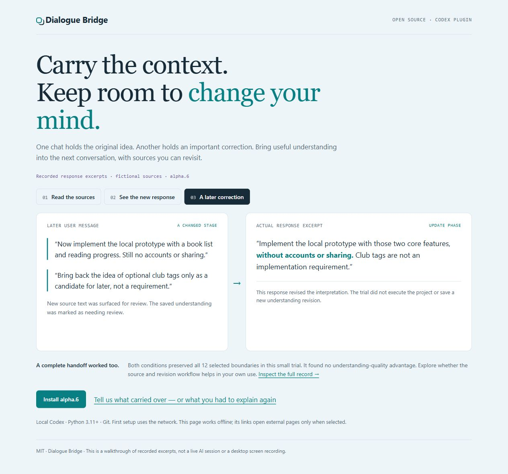

# Carry the context, keep room to change your mind

A short example of what Dialogue Bridge is for. Source messages are fictional;
response excerpts below come from the [recorded response trial](COMPARISON.md).

For a visual version, [download the interactive walkthrough](https://github.com/zhaosknss/codex-dialogue-bridge/releases/download/v0.1.0-alpha.6/dialogue-bridge-walkthrough.html) and open it
in your browser. It works offline and contains recorded excerpts, not a live AI.
The [HTML source](walkthrough.html) is available in this repository.



## 1. The sources hold different parts of the picture

In one source chat:

> I want a small reading-progress app. Let us discuss it first; do not write code yet. Use science-fiction books in the example, but the app should work for other books too.

Another source message:

> The first version should have a book list and reading progress. Sharing is only a candidate feature; it has not been decided.

Later, a branch explores book clubs:

> A separate branch can explore book clubs. Keep that exploration separate until I choose what to bring back to the main app.

The genre is an example, discussion is not implementation, and branch ideas
are not automatically decisions.

## 2. Let a new chat use those sources

Install the existing public alpha.6 release:

```text
codex plugin marketplace add zhaosknss/codex-dialogue-bridge --ref v0.1.0-alpha.6
codex plugin add dialogue-bridge@dialogue-bridge
```

Open a new local Codex chat, select `@Dialogue Bridge`, and paste your source
chat links. Links alone mean "understand this background". You can add a focus.
Use your own links; the synthetic IDs in the trial inputs are not real chats.

In the recorded component trial, the response using the Bridge export included:

> Version one includes a book list and reading progress. Coding is not authorized.

> Sharing remains a candidate. Book-club exploration stays separate until you choose what to bring into the main app.

The plugin provides history access, sources and saved background; the host model
forms the interpretation. A complete ordinary handoff preserved these distinctions too.

## 3. A later message can change the right part

The user later says:

> Now implement the local prototype with a book list and reading progress. Still no accounts or sharing. Bring back the idea of optional club tags only as a candidate for later, not a requirement.

After the fictional source update, the actual context store exposed the new
messages and marked the old saved understanding for review. The recorded response said:

> Implement the local prototype with those two core features, without accounts or sharing. Club tags are not an implementation requirement.

The earlier "discuss first" restriction did not become a permanent rule. The
later authorization did not approve every branch idea. Sources and previous
interpretations remain available when the host reviews and saves a revision.

## Try it on something that matters to you

Requires local Codex, Python 3.11+ and Git; first setup uses the network.
Try a few selected chats with a real correction or change of direction. Notice
what carries over and what you still have to explain.

[Share a rough impression](https://github.com/zhaosknss/codex-dialogue-bridge/issues/new/choose):
what you wanted, what happened, and what felt awkward. You do not need to diagnose
the cause or share private transcripts. Useful successes and "a normal handoff
was easier" are both helpful feedback.
